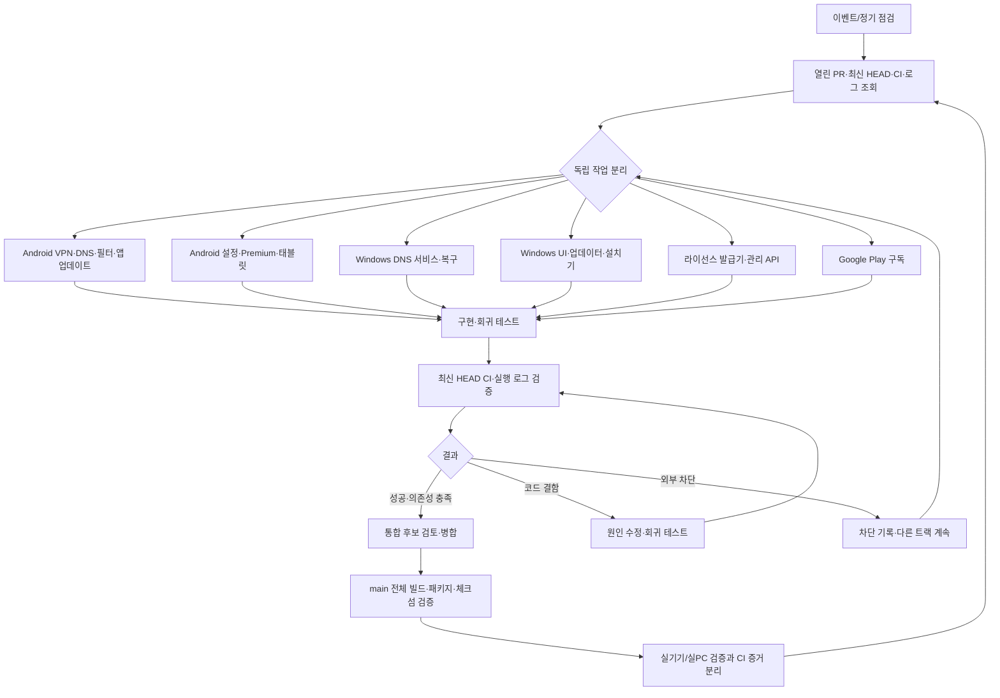

# Guardian 병렬 개발·통합 업무 흐름

## 업무 흐름도

## 트랙별 완료 기준

| 트랙 | 우선순위 | 완료 기준 |
|---|---:|---|
| Android VPN/DNS 보호·차단 | P0 | 최신 HEAD CI, 에뮬레이터 검증, 실제 DNS 차단 경로 확인 |
| Android 앱/필터 업데이트 | P0 | 릴리스 APK·매니페스트·서명·체크섬 일치, 앱 내 업데이트 탐지 |
| Android 설정·Premium·태블릿 | P1 | 반응형 화면, 상태 복원, 실제 기능 연결 |
| Windows DNS 백그라운드 엔진 | P0 | SYSTEM 작업 UDP/TCP 53 응답, 시작·중지·복구 |
| Windows UI·업데이터·설치기 | P1 | 최신 UI, 설치·업데이트·제거·DNS 복원 |
| 라이선스 발급기·관리 API | P1 | 기간·기기 수·고객 이력·연장·정지·회수 검증 |
| Google Play 구독 | P2 | 구매 토큰 서버 검증 및 갱신/취소 상태 동기화 |

## 운영 규칙

1. 매 실행 시 GitHub에서 열린 PR, 최신 HEAD SHA, 연결된 CI와 로그를 새로 조회한다. 이전 보고서의 상태를 재사용하지 않는다.
2. 독립 모듈은 별도 브랜치와 CI로 병렬 진행한다. 같은 파일·공통 API 변경은 충돌을 피하도록 순차 통합한다.
3. 실패는 실제 로그로 원인을 분류한다. runner 미할당/단계 미시작은 코드 결함으로 취급하지 않는다.
4. 수정 가능한 결함은 회귀 테스트와 함께 수정하고, 새 HEAD의 CI까지 확인한다.
5. CI 성공만으로 병합·제품 완료로 보지 않는다. Draft, 충돌, 의존성, 보안 검토를 통과한 변경만 통합한다.
6. production signing, 결제 운영, 비밀값, 실제 고객 발급, 사용자 PC 네트워크 설정은 필요한 승인·자격정보 없이 변경하지 않는다.
7. 한 트랙이 차단되어도 나머지 독립 트랙은 계속한다. 단순 상태 반복 보고 대신 실제 변경·검증·차단 변화만 보고한다.
8. 구현, CI 통과, main 병합, 패키지 검증, 실환경 검증을 각각 구분한다. 증거가 없는 단계는 완료로 표시하지 않는다.

## 자동 실행의 한계
GitHub Actions는 이벤트 또는 예약된 시점에 실행된다. ChatGPT 대화 자체가 24시간 상주 프로세스로 무한 실행되는 것은 아니다. 이벤트 기반 CI와 정기 자동화를 활용해 가능한 범위에서 이어서 처리하며, 실제 실행되지 않는 시간까지 작업 중이라고 주장하지 않는다.
