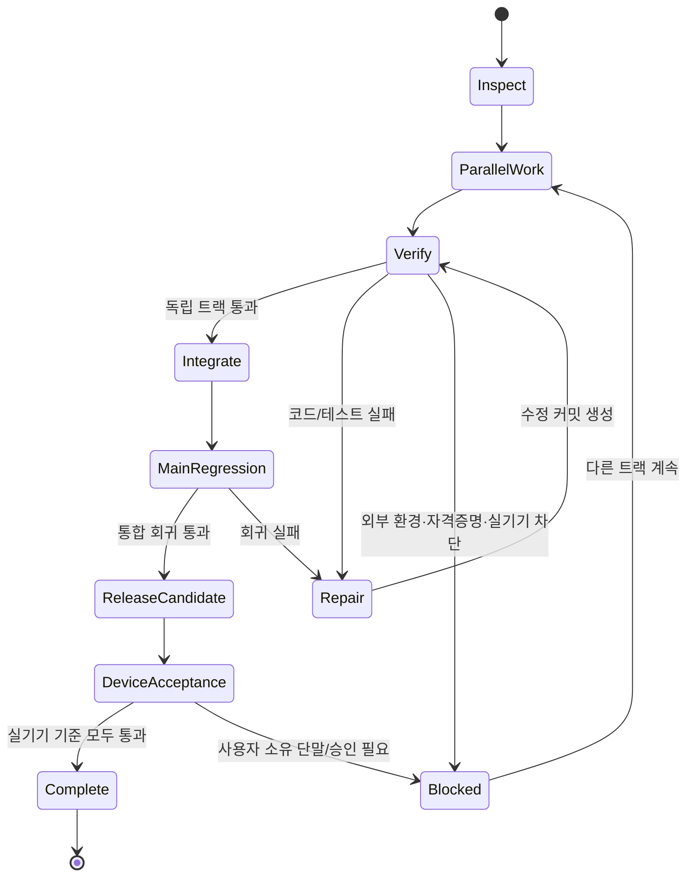

# Guardian 모바일 완료 무중단 수행 프로세스

- 적용 대상: Android 모바일 앱 완료까지의 개발·통합·검증
- 실행 기준: GitHub 저장소의 최신 커밋과 최신 CI 결과
- 완료 판정: 코드 반영, CI, APK, 에뮬레이터, 실제 기기 검증을 각각 증거로 확인
- 운영 원칙: 한 트랙이 막혀도 독립 트랙은 멈추지 않으며, 사용자에게 반복 승인이나 수동 실행을 요구하지 않는다.

## 1. 자동 실행과 작업 지속 구조

1. PR 생성/갱신/재오픈 시 해당 변경의 CI를 실행한다.
2. Android 관련 main 변경 시 통합 빌드와 회귀 검증을 실행한다.
3. 정기 점검은 6시간 간격으로 main의 통합 상태를 재검증한다.
4. 각 실행은 Android 앱, 서버·결제·라이선스, 저장소 무결성 트랙을 병렬 실행한다.
5. Android APK 전용 workflow는 빌드·단위 테스트·Lint·에뮬레이터 VPN/DNS 시나리오를 담당한다. 통합 오케스트레이터는 별도로 서버/결제 계약 및 저장소 상태를 검증한다.
6. 한 작업이 실패하거나 외부 러너가 배정되지 않아도 다른 트랙은 완료까지 실행한다. 실패 분류는 runner/job-start, 코드/테스트, 외부 서비스/자격증명, 실기기 접근 차단으로 구분한다.
7. 실행이 끝나면 원시 로그, 커밋 SHA, APK/체크섬(생성된 경우), 실패 단계, 다음 조치를 아티팩트로 남긴다.
8. 실패한 작업은 원인을 수정한 새 커밋으로 재검증한다. 성공한 이전 커밋의 CI를 새 커밋의 성공으로 재사용하지 않는다.

> GitHub Actions는 이벤트 및 예약 시점에 실행되는 유한 작업이다. 24시간 상주하는 개발 에이전트인 것처럼 표시하지 않는다. 예약 실행 사이에는 runner가 점유되지 않으며, 실제 실행된 결과만 상태로 기록한다.

## 2. 병렬 트랙

| 트랙 | 범위 | 완료 증거 |
|---|---|---|
| A — 보호 엔진 | VPN 권한·TUN 생성/해제·DNS UDP/TCP·DoT/DoH·시작/중지·복구 | 최신 Android unit test, emulator VPN/DNS 차단·허용·중지·복구 E2E, 실제 기기 DNS 결과 |
| B — 필터 엔진 | 기본/선택 필터·사용자 규칙·앱 제외·캐시·오류 복구 | parser/composer/cache 회귀 테스트, 서명 manifest 및 해시 검증, 업데이트 성공/실패/rollback |
| C — 모바일 UI | 홈·보호·활동·설정·Premium·업데이트·앱 제외 | 메뉴 라우팅, 접근성 식별자, 화면 상태, 작은 화면/태블릿 에뮬레이터 검증 |
| D — 앱 업데이트 | 업데이트 확인·다운로드·서명·설치·업그레이드 복구 | 실제 APK package/version/signature/SHA-256, manifest 일치, 구버전에서 인플레이스 업그레이드 E2E |
| E — Premium/라이선스 | 구독 상태·서버 검증·기기 수·기간·만료·취소·갱신 | 서버 단위/HTTP/DB 테스트, 앱 entitlement 동기화 테스트, Google Play 실제 구매는 별도 운영 자격 검증 |
| F — 통합/출시 | 트랙 의존성·릴리스 구성·오류 로그·최종 APK | 모든 필수 트랙의 동일 통합 커밋 성공, 배포 가능한 APK와 소스/검증 자료, 실기기 승인 테스트 |

각 트랙은 독립 브랜치에서 병행하되 동일 파일 또는 공유 인터페이스 충돌은 소유 트랙에서 먼저 정리한다. 기능 브랜치가 오래 열려 있으면 최신 main과 비교해 충돌을 조기에 해결한다.

## 3. 자동 진행 상태 머신

- **Inspect:** 열린 PR, draft 여부, 최신 HEAD, 의존성, 최신 CI 및 실패 로그를 다시 조회한다.
- **ParallelWork:** 독립 작업을 동시에 진행한다. 완료된 트랙은 재작업하지 않고 미완료 트랙으로 자원을 이동한다.
- **Verify:** 새 HEAD의 테스트만 유효하다. 실패 원인을 분류하고 수정 가능한 코드는 수정 커밋을 만든다.
- **Integrate:** 충돌, 보안, API 계약, 기능 중복을 확인한 뒤 통합한다. 자동 병합은 하지 않는다.
- **MainRegression:** 통합 main에서 전체 빌드·단위 테스트·Lint·서버 테스트·APK/E2E를 다시 수행한다.
- **DeviceAcceptance:** Samsung 등 실제 Android 기기에서 VPN 승인, DNS 질의, 차단/허용, 업데이트 설치, 재부팅 복구를 확인한다.
- **Complete:** 아래 모든 완료 게이트가 증거로 충족된 경우에만 종료한다.

## 4. 모바일 완료 게이트 — 하나라도 미충족이면 미완료

1. Android 기능 변경이 모두 main에 통합되어 있고, 필수 PR에 열린 draft/미해결 충돌이 없다.
2. 동일한 최신 main SHA에서 Gradle compile, 전체 unit tests, lint가 성공한다.
3. API 35 에뮬레이터에서 신규 설치와 구버전 인플레이스 업그레이드가 성공한다.
4. VPN 보호 시작/중지/재시작/복구가 성공하고, 테스트 도메인의 차단 응답과 허용 도메인의 정상 응답을 각각 확인한다.
5. 기본 필터 누락, 선택 필터 다운로드 실패, 서명/해시 불일치, 캐시 손상 상황에서 fail-safe 및 복구 동작이 검증된다.
6. 작은 화면과 태블릿 화면에서 주요 메뉴·설정·Premium·업데이트·앱 제외 화면이 잘리거나 겹치지 않는다.
7. 라이선스/구독은 구매·검증·만료·취소·갱신 상태가 앱에 일관되게 반영된다. 운영 결제 자격이 없으면 실결제는 미검증으로 남긴다.
8. 최종 APK의 패키지 ID, versionName/versionCode, 서명 인증서, 파일 크기, SHA-256, 업데이트 manifest가 모두 일치한다.
9. 실제 Android 기기에서 VPN 권한 승인 및 DNS 차단/허용을 확인한다. 에뮬레이터 성공으로 실기기 검증을 대체하지 않는다.
10. 최종 APK, 소스 ZIP, 검증 보고서, 로그, 체크섬을 동일 커밋 기준으로 보존한다.

## 5. 자동화 안전 경계

- GitHub Actions 기본 GitHub-hosted runner만 사용한다. billing/runner 설정, 유료 runner, 외부 AI API 및 별도 유료 서비스는 변경하거나 호출하지 않는다.
- 운영 서명 개인키, Play Console 운영 자격증명, 고객 데이터, 실제 라이선스 발급, DNS/네트워크 설정 변경은 자동화하지 않는다.
- Draft PR, 실패한 검증, 불명확한 라이선스/필터 재배포 권리 상태를 자동 병합/출시하지 않는다.
- CI 통과, APK 생성, emulator 성공, 실기기 성공을 서로 다른 상태로 기록한다.
- runner가 배정되지 않았거나 job step이 시작되지 않은 경우 코드 결함으로 분류하지 않는다.
- 사용자에게 수동 테스트를 요구해야 하는 유일한 구간은 실제 기기의 VPN 승인 및 단말 네트워크 수용처럼 원격 CI가 대신할 수 없는 물리적 검증이다.

## 6. 운영 상태 보고 형식

매 실행 후 새로 조회한 사실만 다음 형식으로 기록한다.

| 항목 | 값 |
|---|---|
| 최신 통합 SHA | 실행한 정확한 커밋 |
| 병렬 트랙 | 통과 / 실패 / 실행 중 / 외부 차단 |
| 실패 원인 | 실패 단계와 로그 근거 |
| 수정 커밋 | 실제 생성된 커밋 또는 없음 |
| APK 증거 | 버전·크기·SHA-256 또는 미생성 |
| 실기기 | 확인 / 미확인 / 접근 차단 |
| 전체 판정 | 미완료 / 출시 후보 / 완료 |

반복적인 진행 문구나 이전 실행의 성공 상태를 재사용하지 않는다. 새로운 코드 변경, 검증 결과, 장애 원인 변화가 있을 때만 의미 있는 업데이트를 남긴다.
