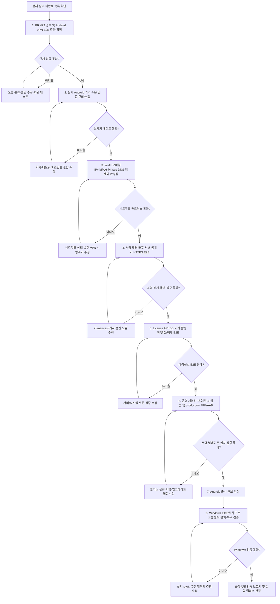

# Guardian 잔여 업무 순차 진행 계획

기준 커밋: `05c374a52b7489c231289db6b866fc1818fee2ea`
기준 PR: [#73 — optional filter fallback and Android VPN startup](https://github.com/justinhblee-prog/guardian/pull/73)
기준 Android CI: [run 43907322511](https://github.com/justinhblee-prog/guardian/actions/runs/43907322511)
상태 갱신: 2026-11-17

## 운영 원칙

이 문서는 Guardian의 남은 일을 하나의 순차 작업 큐로 관리한다.

1. 한 번에 가장 앞에 있는 미완료 단계 하나를 진행한다.
2. 코드 수정 후 관련 단위 테스트 → lint → APK 빌드 → 필요한 통합/E2E 테스트 순으로 검증한다.
3. 성공 근거(커밋, CI 실행, 산출물, 테스트 로그)를 확인한 뒤에만 해당 항목을 완료 처리하고 다음 단계로 이동한다.
4. 일반적인 코드·테스트·빌드 오류는 원인을 찾아 수정하고 재검증한다. 같은 오류가 반복되면 우회로 성공 처리하지 않고 근본 원인을 해결한다.
5. 아래의 중대 중단 조건이 아닌 한 사용자에게 매번 승인이나 '다음' 입력을 요구하지 않는다.
6. GitHub Actions 요금제·결제·사용량 한도를 변경하거나 유료 외부 AI API를 새로 호출하지 않는다.
7. CI 이벤트 감사는 자동화할 수 있지만, 현재 저장소의 GitHub Actions만으로 AI가 임의 코드를 설계·수정·커밋하는 무인 개발 에이전트가 만들어지는 것은 아니다. 실제 코드 작업은 사용 가능한 개발 도구와 저장소 권한 안에서 수행하며, 실행하지 않은 작업을 백그라운드에서 진행 중이라고 표현하지 않는다.

## 업무 흐름도

## 순차 작업 큐

| 순서 | 작업 | 완료 기준 | 상태 |
|---:|---|---|---|
| 1 | PR #73 Android 필터 메모리 최적화 및 VPN 시작 fallback 검토 | 단위 테스트, lint, APK, 에뮬레이터 VPN E2E 성공; PR diff 검토 후 통합 | 진행 중 |
| 2 | 실제 Android 스마트폰 수용 테스트 | VPN 승인/시작/중지, 허용 DNS 응답, 차단 DNS 응답, 일반 인터넷 접속 확인 | 대기 |
| 3 | Android 네트워크 안정성 매트릭스 | Wi-Fi↔모바일 전환, IPv4/IPv6, Private DNS, 앱 제외, 다른 VPN 조합과 복구 확인 | 대기 |
| 4 | 서명 필터 운영 연동 | 실제 HTTPS 배포 URL과 앱 고정 공개키로 manifest 서명·해시·버전 anti-rollback·캐시 원자 교체·실패 복구 확인 | 대기 |
| 5 | 라이선스 운영 연동 | API/DB 운영 배포, 기기 활성화·갱신·해제, 만료/정지, 서명 토큰 검증 E2E 확인 | 대기 |
| 6 | Android production 빌드 | 운영 keystore 및 보호된 CI secrets, production APK/AAB 서명, 설치·업데이트 검증 | 대기 |
| 7 | Android 출시 판정 | 실제 기기/네트워크/서버/서명 증거와 알려진 제한을 문서화 | 대기 |
| 8 | Windows 클라이언트 패키징 | EXE·설치 프로그램 빌드, 설치·실행·제거, DNS 설정 백업/복구, 재부팅 후 복구 검증 | 대기 |
| 9 | 통합 릴리스 문서화 | Android/Windows별 검증 결과와 미지원·미검증 범위를 분리해 최종 보고 | 대기 |

## 중대 오류 — 진행 중단 조건

다음 상황은 일반적인 수정 가능 오류와 구분해 즉시 중단하고 원인 및 영향 범위를 보고한다.

- 운영 개인키, 인증서, 관리자 비밀값 또는 사용자 데이터의 노출 가능성
- DNS/VPN 복구 실패로 사용자의 네트워크 연결이 지속적으로 끊기거나 복구 경로가 없는 문제
- 기존 사용자 데이터·설정·라이선스 상태의 비가역적 손상 또는 데이터 마이그레이션 위험
- 서명 검증 우회, 위조 필터 수락, 권한 상승 등 보안 경계가 무너지는 문제
- 저장소의 보호되지 않은 파괴적 변경, 복구 불가능한 릴리스/배포 작업
- 유료 사용량·결제·외부 서비스 비용 발생이 필요한데 사용자 동의가 없는 경우

그 외의 단위 테스트 실패, lint 경고/오류, 컴파일 오류, 다운로드 재시도 실패, CI 러너 일시 장애, 에뮬레이터 환경 문제는 로그와 단계 정보를 근거로 분류하고 가능한 수정·재검증을 진행한다. 인프라 장애를 앱 코드 결함으로 잘못 분류하지 않는다.

## 증거 및 완료 판정 규칙

- **코드 반영:** 커밋 SHA와 변경 파일로 확인한다.
- **자동화 검증:** 실행 ID와 각 단계 결과로 확인한다.
- **APK 확보:** APK 파일 존재, 크기, SHA-256 및 패키지/versionCode/versionName을 확인한다.
- **에뮬레이터 E2E:** 앱 설치/실행만으로 통과 처리하지 않는다. VPN 활성화, 허용 DNS 실제 응답, 차단 DNS 무응답 및 앱 통계 변화까지 확인한다.
- **실기기 수용 테스트:** 에뮬레이터 결과와 분리해 기록한다.
- **운영 서버:** 로컬 mock/단위 테스트와 실제 HTTPS 운영 환경 E2E를 구분한다.
- **production 릴리스:** debug 서명 APK를 production 산출물로 표시하지 않는다. 운영 서명키가 준비되지 않으면 해당 단계는 보류한다.

## 현재 기준 상태

- Android run `43907322511` (commit `05c374a`)는 2026-11-16 완료, 전체 workflow success.
- Android unit tests, lint, 이전 개발 버전 APK 조립, 현재 APK 조립, APK 패키지/필터 asset/체크섬 확인 통과.
- Android API 35 에뮬레이터 설치·실행 및 `verify_android_emulator.sh`, `verify_android_vpn_emulator.sh` 단계도 성공.
- 따라서 이번 실행의 에뮬레이터 VPN E2E는 통과로 기록한다. 실제 스마트폰 실기기 수용 테스트는 아직 별도다.
- 후보 APK: `Guardian-AdBlock-0.7.13-dev-pr73-05c374a.apk`, 3,102,021 bytes.
- APK SHA-256: `e3c76b8beb99e9fefc2b7d76f3ea41959f80da68817d4b334b5b211b38adc87e`.
- 후보 APK는 개발용 서명본이며 production 릴리스가 아니다.
- 현재 PR #73은 open 상태다. 통합 전 diff/기반 브랜치/최종 CI 상태를 다시 확인한다.

## 변경 기록

- 2026-11-17: 남은 Android → 운영 필터/라이선스 → production signing → Windows 패키징 순서를 명시하고, 중대 오류 기준과 단계별 완료 증거 규칙을 정의했다.
