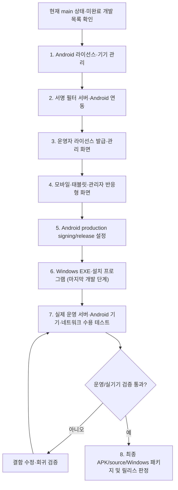
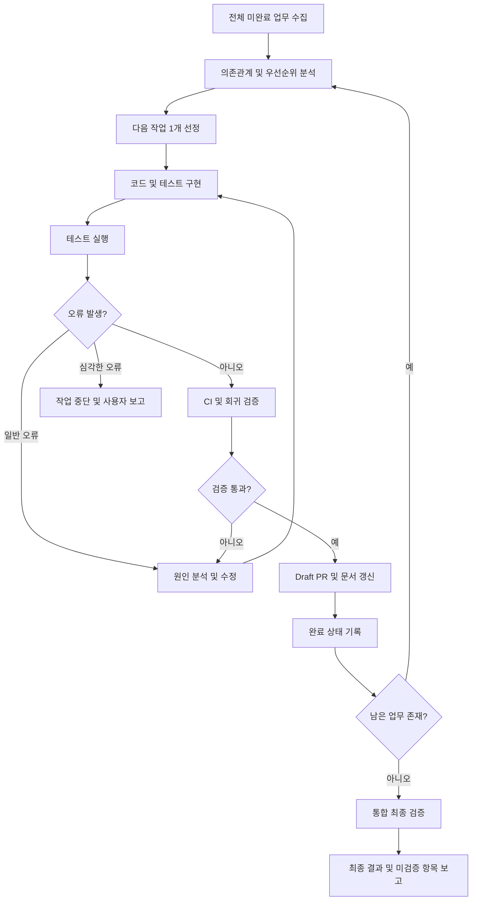

# Guardian 잔여 업무 순차 진행 계획

기준 main 커밋: `c59faf094495fcf8d0289a108584644fa2b0ad11` (PR #129 병합)
최신 main Android CI: [run 44243684769](https://github.com/justinhblee-prog/guardian/actions/runs/44243684769) — 마지막 확인 시 에뮬레이터 설치/실행 단계
최신 완료 Android E2E 증거: [PR #129 run 44242946910](https://github.com/justinhblee-prog/guardian/actions/runs/44242946910) — 성공
최신 License API CI: [run 44243134988](https://github.com/justinhblee-prog/guardian/actions/runs/44243134988) — 성공
상태 갱신: 2026-11-18

## 운영 원칙

이 문서는 Guardian의 개발·운영·검증 업무를 의존관계에 따라 관리한다.

1. Android 모바일과 공통 필터/라이선스 기능을 먼저 완성한다. Windows 실행 파일·설치 프로그램은 마지막 개발 단계로 둔다.
2. 사용자가 요청한 순서대로 기능 구현을 우선하고, 실제 스마트폰·운영 서버·네트워크 매트릭스 검증은 개발 항목을 마친 뒤 진행한다. 단, 코드 회귀 방지를 위한 자동화 테스트와 CI는 각 변경에 계속 수행한다.
3. 독립적인 코드 작업은 병렬로 진행할 수 있지만, 의존성이 있는 배포·서명·출시 단계는 선행 조건을 확인한 뒤 진행한다.
4. 완료 표시는 커밋, CI 실행, APK/소스 산출물, 체크섬, 테스트 로그 등 실제 증거가 있을 때만 한다.
5. 일반적인 코드·테스트·빌드 오류는 원인을 찾아 수정하고 재검증한다. CI 인프라 장애를 앱 코드 결함으로 단정하지 않는다.
6. 운영 개인키·keystore·관리자 비밀값은 저장소나 채팅에 올리지 않는다. 실제 운영 비밀값이 필요한 단계는 안전한 운영 환경 설정 전까지 미완료로 둔다.
7. 사용자에게 매 단계 승인이나 '다음' 입력을 요구하지 않는다. GitHub Actions 요금제·결제·사용량 한도를 변경하거나 유료 외부 AI API를 새로 호출하지 않는다.
8. 실행하지 않은 작업을 백그라운드에서 진행 중이라고 표현하지 않는다. GitHub 이벤트 감사는 산출물 검증 자동화이며, 임의 코드를 스스로 설계·수정하는 무인 개발 에이전트와 구분한다.

## 업무 흐름도

## 명령 실행 루프

아래 반복 루프를 모든 단계에 공통 적용한다. 단계 완료는 실제 검증 증거가 확인된 경우에만 기록한다.

## 순차 작업 큐

| 순서 | 작업 | 완료 기준 | 상태 |
|---:|---|---|---|
| 1 | Android 라이선스·기기 관리 | Android entitlement 확인, 기기 활성화/해제, 만료·정지 처리 및 회귀 테스트 | 코드·CI 완료 / 실제 운영 서버 연결 검증 대기 |
| 2 | 서명 필터 서버·Android 연동 | signed manifest, SHA-256, anti-rollback, publisher/updater 및 distribution CI | 코드·CI 완료 / 운영 키·HTTPS 게시·upstream 상용 재배포 라이선스 검토 대기 |
| 3 | 운영자 라이선스 발급·관리 화면 | 발급, 검색·필터·정렬, 기기별 해제, 라이선스 정지, 감사 로그, 반응형 관리자 화면 | PR #78 병합 · License API CI 성공 |
| 4 | 모바일·태블릿·관리자 반응형 화면 | Android 공통 반응형 UI 및 모바일/데스크톱 관리자 화면 | 코드·CI 완료 / 실제 기기 화면 검증은 후순위 |
| 5 | Android production signing/release | release 설정 검증 및 임시 키 서명 smoke test; production keystore/secrets는 운영 환경에서 별도 설정 | 설정 CI 완료 / 운영 키·secrets 대기 |
| 6 | Windows EXE·설치 프로그램 | Windows 엔진/UI/설치 스크립트 패키징, 설치·제거·DNS 복구·재부팅 검증 | Android/공통 기능 완료 뒤 마지막으로 진행 |
| 7 | 실제 운영·실기기 수용 테스트 | HTTPS 필터 게시, License API/DB 배포, Android VPN/DNS, Wi-Fi/모바일·IPv4/IPv6·Private DNS 검증 | 개발 완료 후 수행 |
| 8 | 최종 패키지·통합 릴리스 문서 | APK, 전체 소스 ZIP, Windows 패키지, 체크섬 및 플랫폼별 미검증 범위 정리 | APK/source 개발 artifact 확보; production/Windows 최종본 대기 |

## 중대 오류 — 진행 중단 조건

다음 상황은 일반적인 수정 가능 오류와 구분해 즉시 중단하고 원인 및 영향 범위를 보고한다.

- 운영 개인키, 인증서, 관리자 비밀값 또는 사용자 데이터의 노출 가능성
- DNS/VPN 복구 실패로 사용자의 네트워크 연결이 지속적으로 끊기거나 복구 경로가 없는 문제
- 기존 사용자 데이터·설정·라이선스 상태의 비가역적 손상 또는 데이터 마이그레이션 위험
- 서명 검증 우회, 위조 필터 수락, 권한 상승 등 보안 경계가 무너지는 문제
- 저장소의 보호되지 않은 파괴적 변경, 복구 불가능한 릴리스/배포 작업
- 유료 사용량·결제·외부 서비스 비용 발생이 필요한데 사용자 동의가 없는 경우

그 외의 단위 테스트 실패, lint 경고/오류, 컴파일 오류, 다운로드 재시도 실패, CI 러너 일시 장애, 에뮬레이터 환경 문제는 로그와 단계 정보를 근거로 분류하고 가능한 수정·재검증을 진행한다. 인프라 장애를 앱 코드 결함으로 잘못 분류하지 않는다.

## 2026-11-18 최신 Android 검증 증거

- PR #128 Android 시작 실패 진단 보강 병합: `4f1e47494caacea595be9326fd3af3cd4ae30538`. 지원 보고서에 시작 실패 단계와 예외 클래스만 포함하고 원본 메시지·로컬 경로는 제외합니다. PR CI [44242872020](https://github.com/justinhblee-prog/guardian/actions/runs/44242872020) 성공, 단위 테스트·에뮬레이터 E2E 포함.
- PR #129 검증 문서 최신화 병합: `c59faf094495fcf8d0289a108584644fa2b0ad11`. PR CI [44242946910](https://github.com/justinhblee-prog/guardian/actions/runs/44242946910) 성공.
- PR #130 PowerShell 필터 검증 스크립트 파서 수정 병합: `c8ff95cfa0e2c1fc9ad6b4298ec4369227a17800`. License API CI [44243134988](https://github.com/justinhblee-prog/guardian/actions/runs/44243134988) 성공.
- PR #131 제3자 필터 라이선스 감사 문서 병합: `d1c50471b106735129eafe604125aad4d430b09b`. GPL-3.0/MPL-2.0 upstream을 운영 배포 승인으로 오해하지 않도록 상용 재배포 전 검토 항목을 명시했습니다.
- PR #127 사용자 지정 규칙 VPN E2E 검증 성공 및 main 병합: `4a3a351b9e21dfd2abd66a24b3cb16a066f060a8`.
- PR #127 검증은 사용자 규칙 입력 후 화면 회전, 저장, VPN DNS 차단 및 차단 카운터 증가를 확인했습니다. 완료 artifact `14399892262`의 APK SHA-256은 `339e3b21ca6b93f5cba3a332475c27c1080ac71778960317830cdb37ec448124`입니다.
- 병합 후 main run [44243684769](https://github.com/justinhblee-prog/guardian/actions/runs/44243684769)은 PR #128 진단 개선과 PR #129 문서 변경을 포함한 `c59faf0` main SHA 기준입니다. 마지막 확인 시 에뮬레이터 설치/실행 단계였습니다.
- 실기기 `Library file not found` 원인은 미확정이며, 실제 휴대전화의 진단 보고서/로그가 없으므로 실기기 해결 상태는 미완료입니다.
- 운영 signing key, 실제 License API/DB 배포, signed filter HTTPS 게시, production APK/AAB는 미완료입니다.

- PR #127 사용자 지정 규칙 VPN E2E 검증 성공 및 main 병합: `4a3a351b9e21dfd2abd66a24b3cb16a066f060a8`.
- PR #127 검증은 사용자 규칙 입력 후 화면 회전, 저장, VPN DNS 차단 및 차단 카운터 증가를 확인했습니다. 완료 artifact `14399892262`의 APK SHA-256은 `339e3b21ca6b93f5cba3a332475c27c1080ac71778960317830cdb37ec448124`입니다.
- 병합 후 main run `44242543546`은 마지막 확인 시 Android lint 이후 APK 조립 단계 진행 중이었습니다. 완료 및 artifact 감사 전까지 main 검증 완료로 표시하지 않습니다.
- 실기기 `Library file not found` 원인은 미확정이며, 실제 휴대전화의 진단 보고서/로그가 없으므로 실기기 해결 상태는 미완료입니다.
- 운영 signing key, 실제 License API/DB 배포, signed filter HTTPS 게시, production APK/AAB는 미완료입니다.

## 2026-11-17 이전 검증 증거

- PR #83 cosmetic scriptlet/procedural selector 안전성 수정 병합: `ea337e5bd36123ca06202f092ea222cf3225ac9c`. Main CI [44066812922](https://github.com/justinhblee-prog/guardian/actions/runs/44066812922) 성공: 단위 테스트, lint, debug APK, 업그레이드 설치, API 35 에뮬레이터 VPN/DNS E2E.
- PR #84 IPv6 TCP/53 확장 헤더 파싱 병합: `e3eefac72ede85709035cff71caa382ca49d7039`. PR CI [44067049572](https://github.com/justinhblee-prog/guardian/actions/runs/44067049572) 및 main CI [44068019346](https://github.com/justinhblee-prog/guardian/actions/runs/44068019346) 성공. Hop-by-Hop/Destination Options 등 제한된 비조각 IPv6 확장 헤더 체인을 처리하고 Fragment 헤더는 재조립 미지원으로 거부합니다.
- PR #85 IPv6 UDP/53 확장 헤더 처리 병합: `73d2c26bff2c94614d41855026767691fd092030`. PR CI [44069078186](https://github.com/justinhblee-prog/guardian/actions/runs/44069078186) 성공: 단위 테스트, lint, APK 빌드, 에뮬레이터 VPN/DNS E2E. UDP checksum/transport length 검증과 malformed/truncated/AH/fragment 거부 회귀 테스트를 포함합니다. IPv6 Fragment 재조립은 여전히 미지원입니다.
- Main run [44066812922](https://github.com/justinhblee-prog/guardian/actions/runs/44066812922) APK: 3,123,218 bytes, SHA-256 `3f8874c97649d5ee3f5aa48edecb2e634663eba097d43a94a05eab48c9873153`; source ZIP 449,067 bytes, SHA-256 `5ab85ecac9d2988b671ddfe8afc8e72d79bd2e1847f8af8975ea4c78fcabf677`. 두 ZIP 무결성 및 APK/source 체크섬을 다운로드 후 독립 확인했습니다.

- main 커밋: `28abc77342f34898dd03c198fef942c0b49a7fe0`.
- PR #78 운영자 라이선스 대시보드 개선 병합, License API main CI [44059072829](https://github.com/justinhblee-prog/guardian/actions/runs/44059072829) 성공.
- PR #79 APK와 동일 커밋의 전체 소스 ZIP/체크섬 패키징 병합.
- Android APK main CI [44060999851](https://github.com/justinhblee-prog/guardian/actions/runs/44060999851) 성공: unit tests, lint, APK 업그레이드 설치, API 35 emulator VPN/DNS E2E. 실제 로그: protection_active=true, dns_queries=8, dns_forwarded=7, dns_blocked=1, dns_ad_blocked=1, dns_failed=0.
- Android artifact: `guardian-android-debug`, APK 3,119,618 bytes, SHA-256 `24db2c1db46a66d2117cb35f7541c893b3321ee7de46363b615fd1a585319c78`.
- 전체 소스 ZIP: 446,281 bytes, SHA-256 `a22d74b994b919e19de4125a719243786b76fa50dbb2d19d85200345afdcee17`.
- 자동 artifact 감사 [44062116800](https://github.com/justinhblee-prog/guardian/actions/runs/44062116800) 성공: APK/source SHA-256 및 ZIP 무결성 모두 통과.
- Signed filter distribution CI [44052664109](https://github.com/justinhblee-prog/guardian/actions/runs/44052664109), main CI [44052665884](https://github.com/justinhblee-prog/guardian/actions/runs/44052665884) 성공.
- Production release 설정 검증 [44052664040](https://github.com/justinhblee-prog/guardian/actions/runs/44052664040) 성공. production signing job은 운영 keystore/secrets가 없어 skipped이며 production APK/AAB는 생성되지 않았습니다.
- 이 검증은 Android 에뮬레이터 결과입니다. 실제 스마트폰/태블릿 VPN/TUN 라우팅, 실제 광고 제거율, 운영 HTTPS/Tailscale 배포는 미검증입니다.

## 증거 및 완료 판정 규칙

- **코드 반영:** 커밋 SHA와 변경 파일로 확인한다.
- **자동화 검증:** 실행 ID와 각 단계 결과로 확인한다.
- **APK 확보:** APK 파일 존재, 크기, SHA-256 및 패키지/versionCode/versionName을 확인한다.
- **에뮬레이터 E2E:** 앱 설치/실행만으로 통과 처리하지 않는다. VPN 활성화, 허용 DNS 실제 응답, 차단 DNS 무응답 및 앱 통계 변화까지 확인한다.
- **실기기 수용 테스트:** 에뮬레이터 결과와 분리해 기록한다.
- **운영 서버:** 로컬 mock/단위 테스트와 실제 HTTPS 운영 환경 E2E를 구분한다.
- **production 릴리스:** debug 서명 APK를 production 산출물로 표시하지 않는다. 운영 서명키가 준비되지 않으면 해당 단계는 보류한다.

## 현재 기준 상태

- PR #73 squash merge: `99ad460bf309fe55b7503fa828d8eb4be25386ea`; PR #77 squash merge: `30a765cf539885f94a5924680a8d055d083afc79`.
- Android 0.7.14-dev PR validation [run 44051352597](https://github.com/justinhblee-prog/guardian/actions/runs/44051352597) completed successfully: unit tests, lint, 0.7.13→0.7.14 upgrade install, API 35 emulator install/launch, VPN activation, allowed DNS response, blocked DNS rejection.
- APK: `com.guardian.adblock`, versionCode 27, versionName `0.7.14-dev`, 3,119,618 bytes. SHA-256: `24db2c1db46a66d2117cb35f7541c893b3321ee7de46363b615fd1a585319c78`.
- VPN E2E: `protection_active=true`, `dns_queries=6`, `dns_forwarded=5`, `dns_blocked=1`, `dns_ad_blocked=1`, `dns_failed=0`. `example.com` resolved to `172.66.147.243`; `guardian-ci-44051352597.doubleclick.net` returned `unknown host`. ICMP ping loss is not reported as DNS failure.
- Signed Filter Distribution run `44052664109`, Filter Distribution CI `44052665884`, License API/PostgreSQL integration `44052664268` succeeded.
- Main Android run `44052664083` and production release configuration run `44052664040` are running at this document update time. Production-release job is skipped because no production keystore/secrets are configured.
- PR #77 adds signed manifest/signature/hash client verification, Windows DPAPI filter signing and public publishing scripts, Tailscale private access, License API setup and scheduled publishing scripts. Actual Windows laptop key creation, public data branch publication, HTTPS/Tailscale operational deployment are not yet performed.
- Real Android phone/tablet acceptance tests, Wi-Fi↔mobile transition, IPv4/IPv6, Private DNS, VPN coexistence and long-running background tests remain outstanding.
- The APK is debug-signed. No production-signed APK/AAB is claimed.

## 변경 기록

- 2026-11-17: 남은 Android → 운영 필터/라이선스 → production signing → Windows 패키징 순서를 명시하고, 중대 오류 기준과 단계별 완료 증거 규칙을 정의했다.

- 2026-11-17: run `43917110473`의 APK SHA-256과 실제 VPN 활성화/허용 DNS/차단 DNS 및 통계 결과를 반영했다. PR #73의 자동 검증은 통과했으나 실기기 수용 테스트와 통합은 별도다.

- 2026-11-17: PR #73을 검토 후 squash merge했고, Android VPN E2E 로그에서 허용 DNS 응답·차단 DNS 실패 및 서비스 통계를 확인했다. 병합 후 main CI run `44047861059` 검증 대기 상태를 기록했다.

- 2026-11-17: PR #77 was squash-merged as `30a765c`; Android 0.7.14-dev PR E2E and signed filter/license API CI evidence recorded. Main-branch post-merge workflows remain in progress at this update.
- 2026-11-17: PR #83, #84, and #85 merged after full Android emulator VPN/DNS E2E success. IPv6 UDP/TCP share bounded extension-header parsing; IPv4/IPv6 fragment reassembly and full TCP retransmission/partial-ACK recovery remain unsupported.
- 2026-11-17: PR #87 adds DNS-over-TCP out-of-order and overlapping-payload regression tests. PR CI is running; no production code changes.

## 2026-11-17 후속 검증 정정 — main run 44091546831

- PR #93 `Prevent first-run filter refresh from racing WorkManager` 병합 커밋: `1b41b4dfd611ae53c446fe2b1a703d9f4bceee61`.
- Main Android workflow [44091546831](https://github.com/justinhblee-prog/guardian/actions/runs/44091546831): 전체 job `success`. Unit tests, lint, debug APK, upgrade install, API 35 emulator install/launch, VPN DNS E2E 및 artifact upload가 모두 성공했습니다.
- 실제 VPN 로그: 터널 활성화, 허용 DNS 성공, 테스트용 `guardian-ci-44091546831.doubleclick.net` 차단, `dns_queries=12`, `dns_forwarded=11`, `dns_blocked=1`, `dns_ad_blocked=1`, `dns_failed=0`.
- APK: 3,124,398 bytes, SHA-256 `e7d6bb03fe1e6b8cb80cba3a5ee4ceef531390a333865a60519ad8790c3e87d4`.
- 전체 소스 ZIP: 450,165 bytes, SHA-256 `e3534e5909e778667f0b28cfdbaa5c166f252f882a51bc164ddb137bfae19970`.
- Artifact를 직접 내려받아 ZIP 내부 APK/source의 실제 크기와 SHA-256을 독립 재계산했습니다. Artifact 보존 만료일은 GitHub의 artifact 설정을 따릅니다.
- PR #13/#14/#15는 이미 병합되었습니다. PR #16은 후속 PR #54로 대체되어 #54가 main에 병합되었습니다. PR #17은 signed-manifest publisher foundation에 재적용된 PR #24로 대체되었고, #24는 해당 feature branch에 병합되었습니다. PR #18은 runner 사전 배정 진단 전용이므로 제품 변경 PR로 재실행/병합하지 않고 닫혔습니다. 따라서 #13~#18의 닫힌 원본 PR을 그대로 재실행하는 대신 유지되는 후속 변경과 최신 main CI를 확인했습니다.
- 이전 runner 배정 문제는 이번 main run에서 재현되지 않았습니다. 별도 billing/usage/Actions 설정은 변경하지 않았습니다.

## 다음 개발·검증 단계의 현재 경계

1. Android 기능 개발 및 에뮬레이터 VPN/DNS 회귀 검증: 현재 main에서 완료.
2. Android 실기기·태블릿 수용 테스트: 미실시.
3. 운영 필터 공개 branch 최초 게시, 운영 공개키와 앱 키 일치, 모바일 HTTPS 다운로드·서명·SHA-256·anti-rollback end-to-end: 미실시.
4. License API/PostgreSQL의 실제 Windows 노트북 배포, Tailscale HTTPS 연결, 발급·갱신·기기 해제 실서버 E2E: 미실시.
5. Production keystore와 보호된 CI secrets가 준비되지 않아 production APK/AAB는 생성하지 않음.
6. Windows EXE/설치 프로그램의 최신 main 기준 빌드·설치·제거 및 실제 어댑터 DNS 복구 검증은 별도 단계이며, 현재 Android 성공을 Windows 완료로 간주하지 않음.

Windows 설치 패키지 workflow는 `.github/workflows/windows-build.yml`에 구성되어 있으나 Windows hosted runner 사용은 사용자 요청 없이 추가 사용량을 발생시키지 않도록 별도 실행하지 않았습니다. Windows 코드/패키지의 검증은 Android CI와 분리해서 판정합니다.

## Windows 패키징 감사 — 기존 실패 원인과 현재 상태

- 기존 Windows build run [43785686270](https://github.com/justinhblee-prog/guardian/actions/runs/43785686270)은 EXE/설치 프로그램 생성까지 성공했으나 설치 후 제거 smoke test에서 실패했습니다.
- 로그의 직접 실패 원인은 제거 직후 `GuardianDnsProxy` 예약 작업이 남아 있는 것이었습니다. 따라서 이 실행은 Windows 설치 패키지 검증 성공으로 간주하지 않습니다.
- 이후 main의 Windows 설치/제거 코드와 workflow가 변경되었습니다. 현재 workflow는 데몬의 실제 하위 폴더 패키징, 런타임 의존성 확인, `--restore-dns` 후 제거, 예약 작업이 등록된 상태에서 직접 제거하는 두 경로, 제거 후 예약 작업 삭제 확인을 별도로 검사합니다.
- 현재 main의 `.github/workflows/windows-build.yml` 및 installer 변경은 정적 검토만 완료했습니다. 이 변경 이후의 Windows hosted-runner 빌드·설치·제거 실행 결과는 아직 없습니다.
- Windows runner 실행은 Android main CI 성공과 별개이며, 실제 Windows PC의 어댑터 DNS 변경·복구, 재부팅, Wi-Fi/Ethernet, VPN 공존성 검증도 별도입니다. 운영 서명 인증서가 없는 개발용 설치 파일은 서명되지 않으며 SmartScreen 경고가 발생할 수 있습니다.

## Windows DNS engine source-package verification — 2026-11-17

- From the exact source ZIP built by main run `44091546831`, extracted the `dns_engine/` and `windows_engine/` source and ran `python -m pytest -q dns_engine windows_engine` in a Linux environment: **26 passed**.
- `python -m compileall -q dns_engine windows_engine`: exit code 0.
- This independently validates the portable DNS engine and mocked Windows integration tests from the exact source artifact. It does not execute Windows PowerShell, Task Scheduler, Inno Setup, Authenticode, Windows adapter DNS changes, or a native Windows EXE.
- Native Windows packaging and install/uninstall verification remain outstanding. The prior Windows runner failure and current unverified changes are recorded above.

## 2026-11-17 최신 main 검증 — PR #94 / run 44097350550

- PR #94 `Fix queued protection resume race after filter update` 병합 커밋: `bc627faf76cb96a190335487f735fdefec52b4f4`.
- 수정 내용: 필터 업데이트 완료 콜백에서 보호 시작 대기 플래그를 UI 스레드에서 스냅샷/초기화하고, 그 시점의 검증된 캐시 준비 상태를 함께 평가합니다. 백그라운드 스레드에서 미리 계산한 오래된 대기 플래그 값 때문에 사용자의 보호 시작 요청이 누락되는 경쟁 조건을 방지합니다. 기존 안전 게이트(활성화된 모든 필터 캐시가 검증된 경우에만 보호 재개)는 유지합니다.
- PR CI run [44095702720](https://github.com/justinhblee-prog/guardian/actions/runs/44095702720): Android unit tests, lint, 이전 개발 APK 업그레이드 빌드, API 35 에뮬레이터 설치/실행 및 VPN DNS E2E 성공.
- Main CI run [44097350550](https://github.com/justinhblee-prog/guardian/actions/runs/44097350550): 전체 job success. Unit tests, lint, 이전 버전 업그레이드, APK 패키지/버전/번들 필터 검사, API 35 에뮬레이터 설치·실행, VPN 권한 승인 및 DNS E2E 성공.
- 실제 VPN E2E 로그: VPN tunnel active, 허용 DNS `example.com` 응답 확인, 테스트 광고 도메인 `guardian-ci-44097350550.doubleclick.net`은 `unknown host`로 차단. 앱 상태 `protection_active=true`, `dns_queries=10`, `dns_forwarded=9`, `dns_blocked=1`, `dns_ad_blocked=1`, `dns_failed=0`.
- APK: `com.guardian.adblock`, versionCode 27, versionName `0.7.14-dev`, 3,124,402 bytes, SHA-256 `5a1ffd469b613d25ebef526ce282890f2ca3c2f1581c05cc1f7261a7a2b7c414`.
- 전체 소스 ZIP: 452,657 bytes, SHA-256 `c227d548bad194d0a3c8806284d71fa4634923840d869804bb44c3f0d44e6e0d`. Artifact ZIP 무결성, APK/source 파일 크기와 SHA-256을 내려받아 독립 재검산했습니다.
- 소스 ZIP을 별도 Linux 환경에서 다시 추출해 `python -m pytest -q dns_engine windows_engine`: **26 passed**; `python -m compileall -q dns_engine windows_engine`: exit 0.
- 에뮬레이터 결과는 Android 실기기 수용 테스트가 아닙니다. 실제 휴대폰/태블릿, Wi-Fi↔모바일 전환, IPv4/IPv6 네트워크 조합, Private DNS 및 장시간 백그라운드 안정성은 미검증입니다.
- APK는 개발용 debug 서명본입니다. 운영 keystore/secrets가 없어 production APK/AAB는 생성하지 않았습니다. 운영 HTTPS 필터 게시/공개키 연결, 실제 License API/DB 배포, Windows native installer의 최신 설치·제거 검증도 미완료입니다.

## 2026-11-17 Windows daemon readiness / installer 검증 — PR #95

- PR #95 병합 커밋: 29ac16c3e6a33fc66cb9bdb322e100916015b356.
- 문제: 이전 Windows 데스크톱은 127.0.0.1:53에서 임의 DNS 응답만 확인해 Guardian DNS daemon이 아닌 다른 로컬 DNS 서비스가 포트를 점유해도 준비 완료로 오인할 수 있었습니다.
- 수정: 데몬이 IPv4/IPv6 UDP/TCP 소켓을 모두 바인딩한 후 PID/heartbeat 파일을 원자적으로 게시하고, 독립 heartbeat thread가 매초 갱신합니다. 데스크톱은 heartbeat 최신성 및 PID의 실제 프로세스 생존을 확인한 뒤 DNS 응답을 추가 검사합니다.
- 중지: 예약 작업 종료 후 PID가 실제 종료됐는지 확인합니다. 종료가 확인되지 않으면 오류를 반환하며 UI에 상태를 알립니다. 기존 DNS 복구 성공과 데몬 종료 성공을 혼동하지 않도록 UI 예외 처리를 추가했습니다.
- 회귀 테스트: heartbeat 유효/만료/미래 timestamp, 죽은 PID, 손상 JSON, 잘못된 marker, 현재 프로세스 생존, 임의 loopback DNS responder 거부 등을 포함합니다.
- PR Windows build/install [run 44100882615](https://github.com/justinhblee-prog/guardian/actions/runs/44100882615): 전체 성공. PyInstaller EXE 2종과 Inno Setup installer 생성, Authenticode 서명 상태 검사, 설치, 데스크톱/daemon self-test, --restore-dns, 예약 작업 삭제, restore 없이 직접 uninstall 후 예약 작업 삭제 검증 모두 통과.
- PR cross-platform engine CI [run 44100882646](https://github.com/justinhblee-prog/guardian/actions/runs/44100882646): Ubuntu 24.04 및 Windows 2022에서 DNS/Windows integration tests 및 compileall 성공. 전체 테스트 33개.
- PR artifact Guardian-AdBlock-Windows-Dev-Package를 직접 다운로드해 ZIP 무결성, 데스크톱 EXE, DNS daemon EXE, 설치 프로그램의 실제 존재·크기·SHA-256을 확인했습니다. 개발용 unsigned 패키지이며 production Authenticode 인증서는 설정되지 않았습니다.
- 병합 후 main Windows build [run 44101373822](https://github.com/justinhblee-prog/guardian/actions/runs/44101373822) 및 cross-platform CI [run 44101373586](https://github.com/justinhblee-prog/guardian/actions/runs/44101373586): 전체 성공. Windows runner에서 EXE/installer 빌드, 서명 상태 검사, 설치 및 smoke test, DNS 복구, 직접 제거 후 예약 작업 삭제까지 통과. Windows 2022와 Ubuntu 24.04의 DNS/Windows integration tests 및 compileall도 통과.
- main Windows artifact: Guardian-AdBlock-Windows-Dev-Package, 49,611,506 bytes, ZIP SHA-256 `f7a1bd8cb8501e6322bed9c4185b081f9ce7f48426d0d1b97bdb3cf40dd4a855`. 다운로드 후 ZIP 무결성 검사 통과.
- Windows desktop EXE: 2,191,180 bytes, SHA-256 `8f59506875b8ee30035e078057b8d564ba11e3c4c0df35cef767228d4ec24946`.
- Windows DNS daemon EXE: 2,088,078 bytes, SHA-256 `ae4a514e7487f10e4478dce7e441b5fa55dab41920beac91c32249a81d0563f5`.
- Windows installer: 21,807,184 bytes, SHA-256 `0f696200422322a399f7e5bbe10d48cc89129db5a89aceee6d426093a438936d`. unsigned development package; production Authenticode certificate is not configured.
- 실제 Windows PC의 네트워크 어댑터 DNS 변경/복구, 재부팅, Wi-Fi/Ethernet 전환, VPN/보안 제품 공존성은 아직 미검증입니다.

## 2026-11-17 최종 통합 재검증 — Android run 44101506633

- Android main CI [run 44101506633](https://github.com/justinhblee-prog/guardian/actions/runs/44101506633): 전체 성공. Unit tests, lint, APK build, 이전 개발 버전 업그레이드, API 35 emulator install/launch, VPN permission, allowed DNS 및 blocked ad-domain E2E, final verification artifact 업로드 통과.
- VPN E2E: protection_active=true, dns_queries=10, dns_forwarded=9, dns_blocked=1, dns_ad_blocked=1, dns_failed=0. 허용 example.com DNS 응답과 guardian-ci-44101506633.doubleclick.net 차단을 확인했습니다.
- APK: com.guardian.adblock, versionCode 27, versionName 0.7.14-dev, 3,124,402 bytes, SHA-256 5a1ffd469b613d25ebef526ce282890f2ca3c2f1581c05cc1f7261a7a2b7c414.
- 전체 소스 ZIP: 457,363 bytes, SHA-256 99538276265f7ed910749421c6bb7257486a92fc088919bdbdeb1560c41bd9ca. ZIP 무결성 및 windows_engine/daemon_health.py 포함 여부 확인.
- 최신 소스 ZIP을 별도 Linux 환경에서 추출해 python -m pytest -q dns_engine windows_engine: **33 passed**; python -m compileall -q dns_engine windows_engine: 통과.
- Windows main build [run 44101373822](https://github.com/justinhblee-prog/guardian/actions/runs/44101373822) 및 cross-platform engine CI [run 44101373586](https://github.com/justinhblee-prog/guardian/actions/runs/44101373586): 전체 성공. Windows installer install/self-test/restore/uninstall 및 예약 작업 정리 경로 통과.
- Android APK는 debug 서명본, Windows installer는 unsigned 개발용입니다. Android/Windows 실기기 수용 테스트, 운영 HTTPS signed-filter 배포, 실제 License API/PostgreSQL 배포, production signing은 별도 미완료입니다.

## 2026-11-18 최신 Android 시작 진단 및 main 검증 — PR #114~#116

- PR #114 `Report unexpected VPN startup and native library failures` 병합: `77e29265dc95f21e31299fbdad0df2ab69b9e919`. VPN startup 경로의 예기치 않은 `Exception`/ `LinkageError`를 기록하고, stale start 요청을 보호하며 partial TUN/foreground 상태를 정리하고 실패 상태를 게시합니다.
- PR #115 `Handle Android VPN packet loop linkage failures` 병합: `4e3b0546180bed044f1a58274aa055c217df0c04`. 패킷 루프의 `LinkageError`도 finally cleanup과 실패 상태 보고를 거치도록 했습니다.
- PR #116 `Report Android filter readiness linkage errors` 병합: `d95c7f6fb87803577e0a4ea758bbe4dfe2a68968`. 보호 시작 전 filter cache readiness 검사에서 발생하는 `LinkageError`를 로그와 사용자 표시 오류로 전달하고 버튼 상태를 복구합니다.
- PR #116 CI [44213013986](https://github.com/justinhblee-prog/guardian/actions/runs/44213013986) 및 병합 후 main CI [44213812389](https://github.com/justinhblee-prog/guardian/actions/runs/44213812389) 전체 성공. Main run에서 Android unit tests, lint, APK 조립/asset/package/checksum, API 35 emulator install/launch 및 VPN DNS E2E 통과.
- main APK: `com.guardian.adblock`, versionCode 27, `0.7.14-dev`, 3,125,266 bytes, SHA-256 `0ab54e099de1e69264b143757973b012e2a3d29c8627c4385fda5a794816ca0d`.
- Source ZIP: 471,471 bytes, SHA-256 `b8b766b6ab0c15742372ce36ec16c882575e00c6cda3c3f7f65d0adfe5b63261`. 다운로드 후 ZIP 무결성 및 내부 파일 checksum을 재확인했습니다.
- CI는 APK 내부 `assets/filter_rules.txt`가 존재하고 `shared/filter_rules.txt`와 byte-for-byte 일치함을 확인합니다. 그러나 이는 실기기에서 사용자가 본 `Library file not found`의 원인을 특정하거나 해결했음을 뜻하지 않습니다. 실기기 파일 상태와 logcat 증거가 없어 해당 오류는 미해결/미검증으로 유지합니다.
- 운영 keystore/secrets 및 실제 signed-filter HTTPS 게시·License API 운영 주소/키가 확인되지 않아 production APK/AAB는 생성하지 않았습니다. 실기기 VPN/광고 제거 수용 테스트도 미실시입니다.

## 다음 작업 우선순위 정정

1. Android 실기기 오류 진단에 필요한 앱 내 진단 수집·오류 메시지 정합성을 코드 수준에서 보강하되, 실제 기기 로그가 없으면 root cause 해결로 표시하지 않습니다.
2. Android 앱/라이선스/필터 배포의 운영 준비 코드와 자동화 검증을 완료합니다. 실제 로컬 키 생성, GitHub secrets/variables 변경, Tailscale/서버 실행은 사용자 PC와 운영 계정에 영향을 주므로 사전조건과 권한이 확인되기 전 실행하지 않습니다.
3. Android tablet responsive/rotation 및 device lifecycle 테스트를 추가합니다.
4. Windows 최신 패키징/설치 검증은 Android 우선 개발을 마친 뒤 진행합니다.
5. 운영 서버·실기기 acceptance와 production signing은 필요한 운영 키/장치/서버가 제공된 이후 별도 완료 판정합니다.
